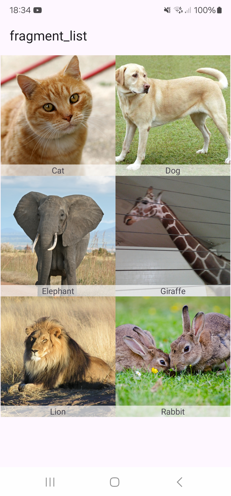
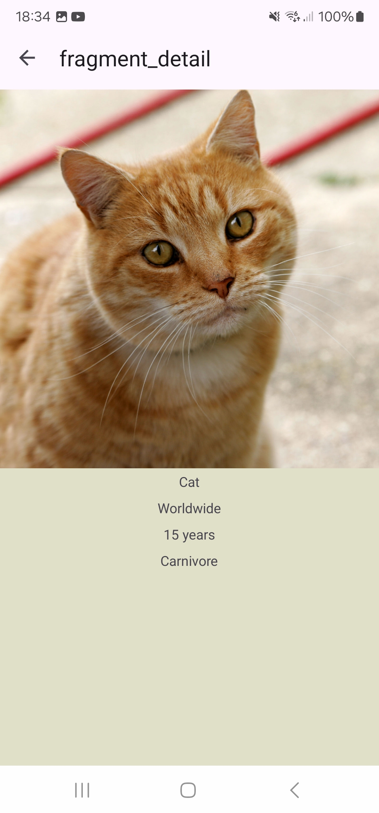
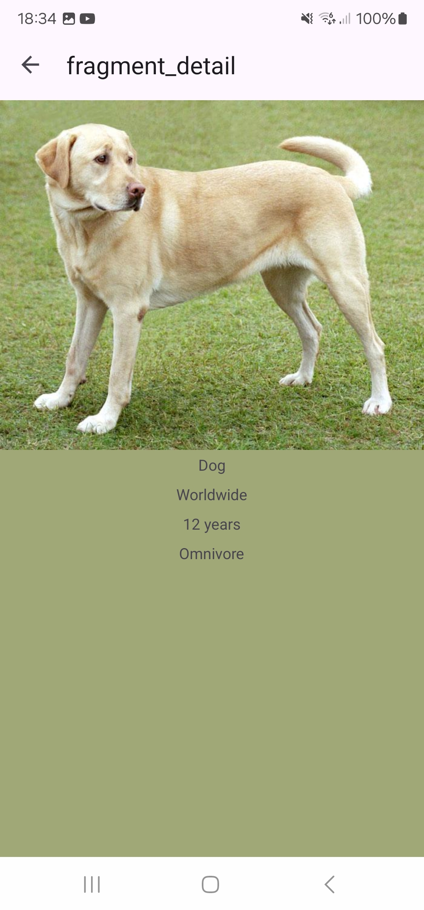

# Android Java/XML Refresher

A small Android project built with **Java and XML views** as a practical refresher after working mostly with Kotlin. The app browses animal cards and opens a detail screen with more information and an image.

## Screenshots

<table>
  <tr>
    <td align="center">Animal list<br></td>
    <td align="center">Cat detail<br></td>
    <td align="center">Dog detail<br></td>
  </tr>
</table>

## What it demonstrates

- Fragments, Android lifecycle handling, and Navigation Component with Safe Args
- MVVM with `ViewModel` and `LiveData`
- `RecyclerView` with a custom adapter
- XML layouts with Data Binding, plus View Binding in fragments
- Retrofit and RxJava 2 for asynchronous API requests
- Dagger 2 dependency injection
- SharedPreferences for a locally cached API key
- Glide image loading and Palette color extraction
- JUnit and Mockito unit tests

## Run the app

1. Open the project in Android Studio and let Gradle sync.
2. Start the included local API server:

   ```powershell
   python tools/animals-api/server.py
   ```

   It uses Python's standard library and needs no package installation.

3. Run the `app` configuration on an Android emulator. The default API address, `http://10.0.2.2:8080/`, connects the emulator to the server on your computer.

For a USB-connected phone, run `adb reverse tcp:8080 tcp:8080` and add this line to the root `local.properties` file:

```properties
ANIMALS_API_BASE_URL=http://127.0.0.1:8080/
```

For a phone connected over Wi-Fi, start the server with `python tools/animals-api/server.py --host 0.0.0.0` and set `ANIMALS_API_BASE_URL` in `local.properties` to your computer's LAN address. Keep `local.properties` local; it is ignored by Git.

The local server uses plain HTTP for development. Cleartext traffic is enabled only in the Android debug manifest; this setup is not intended for production deployment.

## Build and unit tests

On Windows, run these commands from the project root:

```powershell
.\gradlew.bat assembleDebug
.\gradlew.bat testDebugUnitTest
```

## Demo API and image sources

The companion API returns illustrative animal metadata and image URLs. Each animal response includes an `imageSource` field linking to its Wikimedia Commons file page. See [`tools/animals-api/README.md`](tools/animals-api/README.md) for details.

## Project status

This is a learning and portfolio project focused on Java/XML Android development. It is not presented as a production-ready app.


